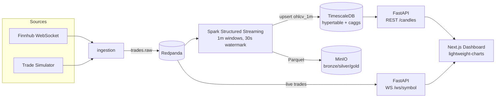
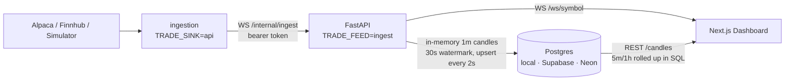

# Stock Streaming Platform

Real-time US stock market streaming pipeline — from raw trades to a live candlestick
dashboard — built as a portfolio project on a fully containerized stack.

**Stack:** Redpanda (Kafka) · Spark Structured Streaming · TimescaleDB · MinIO ·
FastAPI · Next.js + lightweight-charts

## Architecture



## Quickstart

```bash
cp .env.example .env        # defaults work out of the box (simulator mode)
docker compose up -d --build
```

| UI | URL |
|---|---|
| Dashboard | http://localhost:3000 |
| API docs (OpenAPI) | http://localhost:8000/docs |
| Redpanda Console | http://localhost:8080 |
| MinIO Console | http://localhost:9001 |

No market data API key required: by default `TRADE_SOURCE=simulator` generates
synthetic trades (random walk) so the whole pipeline runs 24/7 — even when US
markets are closed. For real data set `TRADE_SOURCE=alpaca` + `ALPACA_API_KEY` /
`ALPACA_API_SECRET` (free IEX feed), or `TRADE_SOURCE=finnhub` + `FINNHUB_API_KEY`.

## Lite stack (production, ~1 GB VM)

The full stack needs ~4–5 GB RAM. `docker-compose.prod.yml` runs the same dashboard
without Redpanda, Spark or MinIO, in well under 512 MB:



```bash
make lite-up                # api + ingestion + local Postgres + dashboard (profile "local")
make backfill DAYS=5        # optional: historical 1m bars from Alpaca
```

Without `--profile local` only `api` + `ingestion` start; point `PG_*` at a managed
Postgres and host the frontend on Vercel. Measured memory: api ~55 MB, ingestion ~35 MB.

## API

| Endpoint | Purpose |
|---|---|
| `GET /candles?symbol=&interval=1m\|5m\|1h\|1d&limit=` | OHLCV candles, oldest first. `1d`: past days from Alpaca daily bars, today rolled up live |
| `WS /ws/{symbol}` | Live trades for a tracked symbol |
| `GET /quotes?symbols=` | Last price, change vs previous close, day range (Alpaca snapshot + live feed) |
| `GET /market/status` | `pre` / `regular` / `post` / `closed` + next change, from the exchange calendar |
| `GET /symbols`, `/symbols/details` | Tracked symbols (with company name and exchange) |
| `GET /health`, `/health/feed` | Liveness + deployed version; data freshness (503 when the feed stalls) |

Includes pre-market and after-hours. Live data comes from Alpaca's free IEX feed; a
nightly reconcile replaces it with SIP bars (all exchanges) and fills any gaps.

## Deployment

Production runs the lite stack on a free Oracle Cloud VM (1 GB RAM) behind Caddy, with
the dashboard on Vercel:

- **CI** (`.github/workflows/ci.yml`): ruff + pytest per service, compose validation
- **Deploy** (`.github/workflows/deploy.yml`): after CI passes on `master`, build images
  to GHCR, pull + restart on the VM over SSH, then wait for `/health` to report the new
  version. Rollback = re-run with an earlier `image_tag`.
- **VM setup**: `deploy/bootstrap.sh` (swap, Docker network), `deploy/caddy/` (HTTPS,
  `/internal/*` blocked at the edge), `deploy/compose.vm.yml` (Postgres tuned to ~45 MB,
  512 MB total memory limit)

Step-by-step setup and operations: [`docs/runbook.md`](docs/runbook.md) (Thai).

## Design notes

- **Event-time processing:** Spark aggregates OHLCV with 1-minute event-time windows
  and a 30s watermark, so late trades still land in the right candle.
- **Medallion layout on MinIO:** raw trades → bronze Parquet; aggregates → silver.
- **Serving layer:** TimescaleDB hypertable `ohlcv_1m` with continuous aggregates
  (`ohlcv_5m`, `ohlcv_1h`) for cheap multi-interval reads.
- **Environment-aware processing:** Spark for dev; on memory-constrained VMs the API
  aggregates candles itself (`api/src/aggregator.py`, same watermark semantics) and
  ingestion pushes trades to it directly instead of through Kafka. On startup it reloads
  the last two minutes from the DB so a restart mid-minute does not truncate a candle.
- **Portable schema:** `001_schema.sql` is plain Postgres; only `002_hypertables.sql`
  needs TimescaleDB. With `CANDLE_ROLLUP=sql` the API builds 5m/1h candles with
  `date_bin()` instead of continuous aggregates (Supabase/Neon don't offer them).

## Roadmap

- [x] Local stack: ingestion → Redpanda → Spark → TimescaleDB/MinIO → API → dashboard
- [x] Lite stack for small VMs (`docker-compose.prod.yml`)
- [x] Alpaca source (real-time IEX trades) + historical 1m backfill
- [ ] CI/CD (GitHub Actions → GHCR, SSH deploy) — workflows written, first run pending
- [ ] Deploy: Oracle Cloud VM + Caddy + Vercel — see `docs/runbook.md`
- [x] Backend hardening: market sessions, quotes, daily candles, reconcile, rate limits
- [ ] Managed Postgres (Supabase) + watchlists
- [ ] News summaries + alerts
